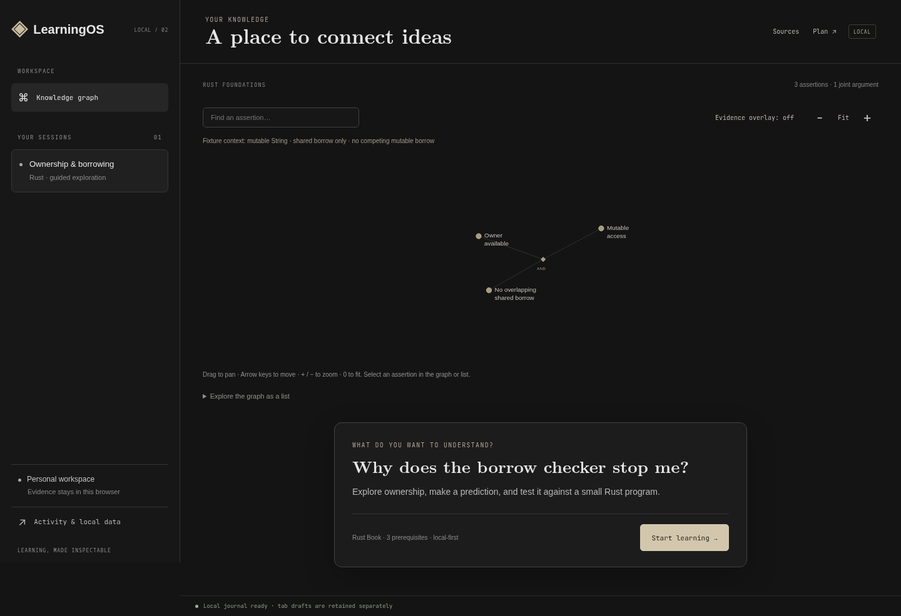
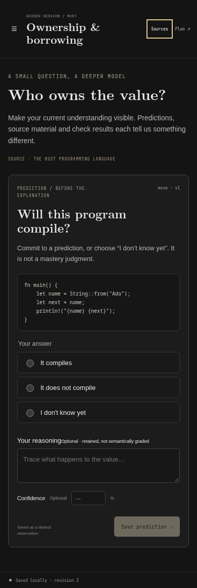

# The first offline LearningOS slice

Refs #52; based on the authorized [execution contract](v2-execution-contract.md).
The Python app, SQLite history, thesis and existing tests remain intact. The new
runtime does not import them or upload browser evidence.

## Run and verify

Install the pinned toolchain from `rust-toolchain.toml`, Node 24.19.0 and
`wasm-bindgen-cli` 0.2.129 (`cargo install wasm-bindgen-cli --version 0.2.129 --locked`).
Then, from the repository root:

```sh
scripts/build-v2.sh coherent
cargo run --locked -p learningos-server --release
# http://127.0.0.1:3000 or /session/ownership
scripts/check-v2.sh
```

The server accepts `LEARNINGOS_ADDR`, `LEARNINGOS_ASSETS` and
`LEARNINGOS_CATALOG`. Its default catalog is `learningos-v2-catalog.sqlite3`;
no legacy database is migrated. `GET /api/v1/lesson` returns the versioned catalog
bundle, `GET /source/ownership` and `/source/borrowing` return
plain text, and the page is SSR plus Leptos islands. Existing immutable fixture
content or a future catalog schema cannot be silently overwritten.

Build equivalent, isolated research candidates without replacing an active app:

```sh
scripts/build-v2.sh coherent /tmp/learningos-coherent
scripts/build-v2.sh split /tmp/learningos-split
LEARNINGOS_ADDR=127.0.0.1:4302 LEARNINGOS_ASSETS=/tmp/learningos-coherent/assets \
  LEARNINGOS_CATALOG=/tmp/learningos-coherent-catalog.sqlite3 \
  /tmp/learningos-coherent/learningos-server
# Run the split candidate on another port with its own catalog and asset directory.
```

Each isolated directory includes its binary, assets and hash manifest. Only the
selected island wrappers are exported. Both candidates use the same fixture,
store, actual UI, stripped WASM name/producers sections and deterministic gzip
assets served through `ServeDir.precompressed_gzip()`. The cache identifier binds
all static asset bytes, service-worker template and compiled SSR server. Default
service-worker waiting/activation preserves an active session; no `skipWaiting`
or forced takeover is called.

`tests/browser` uses locked Playwright 1.56.1 and axe 4.11.1. Set
`PW_CHROMIUM_EXECUTABLE_PATH` to use an existing Chrome binary. Native/WASM parity
uses `artifacts/v2/golden-replay.json`, generated by `scripts/check-v2.sh` from the
native replay example. The scoped v2 GitHub workflow is an inactive review template
at [docs/ci/v2-offline-slice.yml](../ci/v2-offline-slice.yml). GitHub rejected the
initial push because the current OAuth credential lacks the `workflow` scope;
activation under `.github/workflows/` remains pending. It does not replace the legacy
CI issue. Its checkout/setup-node SHA references and used input contracts were
resolved/read from the official repositories on 2026-10-25. A local pass does not
claim a hosted CI run.

## Evidence and assistance

The application owns typed commands; the domain owns valid transitions. The
browser adapter commits an operation's event batch, receipt and projection in one
strict IndexedDB transaction. Duplicate operation lookup precedes revision CAS.
A second tab's stale save retains its draft; reload loads a fresh snapshot before
retrying. Success follows transaction completion. A committed response followed
by failed draft cleanup is explicitly described as committed, with receipt-based
recovery, rather than reported as an unsuccessful journal write.

Prediction, reading thoughts, answer reasoning, optional confidence, structured
answer and hint/source assistance are distinct. Free text is retained and never
semantically graded. Opening Sources during prediction or a closed/open check
first commits bounded source-consultation context, then reveals the source. Such
a check is assisted and cannot count as unaided or immediately trigger transfer.
Correcting/retracting an observation appends linked events; originals and their
conditions remain available. Prediction corrections retain their prediction kind
and return to evidence rather than reopening teaching.

Questions and evaluations bind exact question-artifact and rubric-artifact hashes.
Backups bind the complete fixture digest, ordered events, original requests and
receipts. The joint argument is explicitly scoped to a mutable String binding,
only a shared borrow in scope and no competing mutable borrow. E0596/E0499
counterexamples supplement the E0382/E0502 and two valid compiler fixtures; the
pair of displayed premises is not presented as a universal mutation rule.

## Local data, bounds and recovery

The browser evidence namespace is `learningos-v2-evidence-1`, schema 1. The current
adapter stores a bounded compact journal and a disposable snapshot as JSON-string
records in one object store. Undefined means absent; wrong types, malformed JSON,
unsupported versions, digest mismatches and snapshot disagreement fail closed.
Archive and snapshot verification reads share one readonly transaction, avoiding
false corruption reports during another tab's commit. No alternative empty backend
is opened on failure. The native `SqliteJournal` is a conformance adapter; the
running server exposes no evidence-upload endpoint.

The initial bounds are 10,000 events, 2,000 observations, two hints per attempt,
4,096 UTF-8 bytes per thinking field, 16 KiB per public local command and 8 MiB per
compact local journal/import. The browser adapter rewrites that bounded archive
on commit; this is O(history bytes), not a constant-cost per-event append. Snapshot
command execution avoids replaying the full history. Boot/import/export validate
all events and receipt bindings. Owned transitions avoid cloning the entire
history for every receipt. `bounded_journal` produces the maximal-event fixture
and measures decision, replay and backup verification separately:

```sh
cargo run --locked --release -p learningos-application --example bounded_journal \
  -- /tmp/learningos-maximal-backup.json
```

Storage-mechanism research timings must not be reported as timings of this
whole-archive application adapter. Its actual browser maximal-archive timing is a
separate verification gate.

Drafts use per-tab keys and monotonic generations checked inside the transaction:
late older saves cannot replace newer input or a pending request. A live
BroadcastChannel claim detects the sessionStorage ID copied by Duplicate tab and
allocates a fresh namespace. Normal reload keeps the identity. A new tab without
its own draft copies the latest retained draft on first modification; originals
remain. Up to 64 tab drafts are retained. Drafts are separate from evidence and
from evidence-only exports. Reload reconciles existing exact receipts and persists
pending cleanup. Quota failures preserve the current tab and its pending ID;
never close the only unsaved tab while resolving that error.

Export/import preserves receipt retry behavior. Import requires an empty journal,
checked inside its transaction. Clearing journal and drafts requires typing
`CLEAR`; cached public lesson assets remain. Browser eviction, user clearing and
hardware failure remain durability limits. Persistent-storage permission is
requested without promising immunity. Unsupported upgrades direct the learner to
close other tabs or use the newer app to export.

## UI and verification surfaces

The independently authored UI follows the pinned LearnHarness palette, typography,
sidebar, graph home, serif title, transcript, plan marginalia and question dock.
The graph has bounded keyboard/pointer camera controls, search/list selection,
source/context inspection and an observation-count/uncertainty overlay. It never
colors a source assertion as mastered. Below 928px navigation becomes a focusable
modal drawer; source/plan/activity use sheets with focus restoration. Reduced
motion, visible focus and rem-based text reflow are deliberate accessibility
changes. Source text is rendered as text, never injected HTML.

Use the requested Composite UI Toolkit against this existing app (`ui-kit
capture/check --url`), not a replacement HTML prototype. Its fresh-profile Firefox
checks block service workers and complement the application's actual offline tests.
A test-only proxy may add the hash of its exact text-spacing style to the production
CSP for that audit; production CSP is unchanged. Retain failed runs and inspect
screenshots/incomplete axe checks. The named fonts are local: Source Sans 3 5.3.1,
JetBrains Mono 5.3.0 and the upstream CMU Serif asset, with licenses/manifests.
Upstream Fontsource manifests describe the downloaded package inventory; the app
ships only its selected Latin normal weights.

The renderer experiment is `/graph-benchmark?renderer=svg&nodes=1000` (or `canvas`,
`10000`). Seed 42, positions, camera, culling, screen-size labels, DPR and semantic
AND-argument list are equivalent. SVG retains geometry between frames; Canvas
redraws it. `graph_frame(renderer,count,x,y,zoom)` reports Rust draw-submission time;
measure paint/frame intervals separately. `#benchmark-stage` exposes readiness,
count, renderer and DPR. The actual app exposes `#main` data-ready/data-phase/
data-variant and versioned Rust JSON replay/local-command/backup/draft entry points
for verification.

Real Android installation/offline/performance is an owner-run release gate. Safari
is unmeasured. Automated axe, desktop mobile emulation and a screen-reader process
that could not successfully attach do not satisfy those gates. Refer to the
independent experiment reports for actual measurements and unresolved evidence.
The next bounded content milestone remains one reviewed local Markdown source,
immutable spans/assertions and a second offline lesson.

## Progress checkpoint — 2026-10-25

This is a reviewable implementation checkpoint, not completion of issue #52 or a
release claim. The owner requested a stopping point, progress commit and push.
The feature remains a draft while the following gates remain outstanding.

Verified on the current coherent checkpoint:

- `cargo fmt --all --check`: passed.
- `cargo clippy --locked --workspace --all-targets -- -D warnings`: passed.
- Hydrate-target Clippy with warnings denied: passed, including the final focus fix.
- `cargo test --locked --workspace`: 22 native/compiler tests passed. The last
  subsequent change was browser-only source-dialog focus restoration.
- Coherent and split release bundles built. The final browser-only focus fix was
  rebuilt into the coherent checkpoint; the older split review1 bundle is not a
  final matched comparison. Current split hydrate `cargo check` passed.
- All 11 Chromium Playwright checks (Google Chrome 155.0.8059.79) passed against
  `http://127.0.0.1:4302`, explicitly using
  `/tmp/learningos-coherent-checkpoint/learningos-server` and its isolated assets.
  They cover the offline loop, exact thoughts/confidence, receipt retry,
  correction, export/import/confirmed clearing, two-tab drafts/CAS, native/WASM
  parity, four-viewport keyboard/focus/axe/text reflow, source/hint assistance,
  graph controls and malformed-record rejection. The old :3000 server was not
  the tested application. See [browser result record](checkpoint-browser-results.json)
  and [artifact hashes](checkpoint-build-manifest.txt).
- The source-dialog regression found in review1 is retained in the work history:
  the assistance save disabled its button before the opener was remembered.
  Capturing that opener before saving corrected focus return; all four viewport
  assertions now pass. Tests were not weakened.
- Actual HTTP headers confirmed gzip serving of WASM with the production CSP.

Existing screenshots from that passing run are retained at 1440×900, 1280×720,
390×844 and 360×740 in `docs/ui-reference/checkpoint-2026-10-25/`:





Remaining acceptance work: the final matched island and graph performance campaign,
actual browser maximal-archive measurements, a complete final cross-browser
lifecycle/fault and accessibility run, CI workflow activation and hosted execution, successful screen-reader
output, and physical Android installation/performance. Safari remains unmeasured.
The independent research checkpoint preserves its actual SIGKILL, quota/version,
security and earlier UI results plus failed attempts; those do not imply final
release acceptance. No additional performance campaign was started for this
bounded stopping point. The final coherent focus fix has not been rerun in Firefox.
The research scripts and maximal-journal fixture are preserved for continuation.
