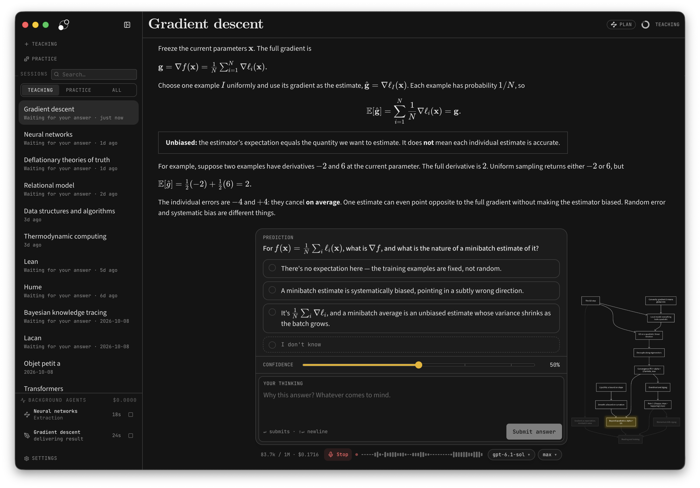
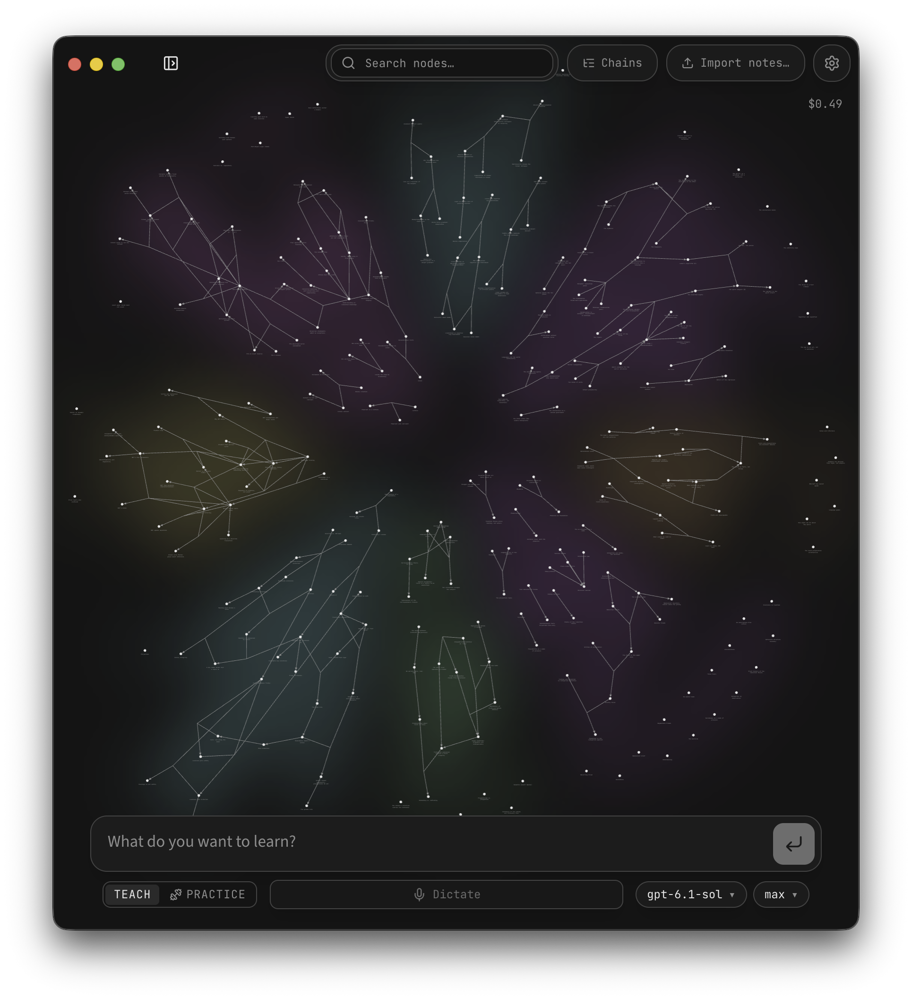

# LearnHarness fidelity baseline

Reference: [amosblomqvist/learnharness](https://github.com/amosblomqvist/learnharness)
at **0795ef197cca04f6a8e7d50d10ed4dc71bd1a0cc**, package 0.3.7.
The following are the upstream repository's actual screenshots, not newly captured
runtime screenshots. Their presence in this commit does not establish that every
pixel depicts that commit. Runtime four-viewport comparisons belong to the slice's
browser evidence and must be labeled separately.

| Region | Source and interaction annotation |
|---|---|
| Left navigation | `components/sidebar.tsx`: session search/filter/list, teaching/practice entry points, activity at foot. Desktop width 288px; auto-close threshold 928px is Electron-oriented. |
| Top bar | `components/top-bar.tsx`: 60px band, 32px serif session title, plan/phase controls. No imitation OS traffic-light buttons in the PWA. |
| Transcript | `components/chat.tsx`: reading content above dock; collapse behavior preserves partial input. V2 state comes from application transitions, not transcript parsing. |
| Question dock | `components/question-dock.tsx`: open prediction; checks wait behind a learner-controlled reveal; confidence and thinking remain distinct. |
| Plan marginalia | `components/plan-window.tsx`: bare diagram alongside the question dock; top-bar plan access remains available. |
| Thinking | `components/reading-thinking.tsx`: thinking while reading is a different channel from answer reasoning. |
| Activity | `components/activity-dock.tsx`: sidebar status surface, stable updates and explicit errors; v2 reports actual local saves/evaluations, not fictional background agents. |

`components/home.tsx` uses a full-bleed graph below floating controls and a centered
bottom composer. `graph-view.tsx` provides search and inspection; `graph-canvas.ts`
uses Canvas2D, camera fit and zoom-dependent label fading. Reproduce those visible
behaviors independently. Arguments render through implication junctions without
changing their joint-premise meaning. Include a structured keyboard list.

## Tokens observed in `app/globals.css`

| Concern | Baseline |
|---|---|
| Background / raised / border | #141414 / #1c1c1c / #434343 |
| Text / muted / selection | #e6e6e6 / #8d8d8d / #2a2a2a |
| Fonts | Source Sans 3 prose, JetBrains Mono controls, CMU Serif bold titles |
| Type | 11, 12.5, 14, 16, 20, 25, 32px; prose 16px with 1.5 leading |
| Rhythm | 4px spacing; radii 4/8/12/16px; dock max width 46rem |

Do not copy the reference's global focus-outline suppression. Use visible focus,
contrast checks and semantic controls. Below 928px, navigation becomes an accessible
drawer; plan/source/activity become sheets. The answer remains usable with a soft
keyboard, 200% text scaling and reduced motion. Preserve density at 1440×900 and
1280×720; test reflow at 390×844 and 360×740.

## Fidelity acceptance

- Graph home, sidebar and centered composer recognizable without LearnHarness marks.
- Serif session title, transcript, question dock and plan diagram preserve hierarchy.
- Prediction is open before teaching; check is closed after teaching; reveal is explicit.
- Fields survive collapse, navigation, reload and offline resume.
- Keyboard focus is visible; drawers restore focus; graph list exposes the same entities.
- Source inspector identifies immutable span/version and explains assertion/evidence.
- Mobile avoids horizontal page overflow and obstructed submit controls.
- Capture screenshots for graph, prediction, teaching, open check and evidence states.
  Record deliberate differences; do not claim a numerical pixel match across different
  lesson text. Compare landmarks and tokens, then maintain deterministic v2 snapshots.

## Attribution and separation

LearnHarness is AGPL-3.0-only. These two screenshots are reference material attributed
to Amos Blomqvist and contributors under the upstream license. No LearnHarness logo,
trademark, prompt, agent pipeline or store is a LearningOS runtime dependency. Retain
font licenses for any separately distributed font assets. The existing repository
license remains unchanged. This inventory records provenance, not legal advice.

The prober/teacher/practice/extraction sources were read for intent and failure cases.
The reference's trusted extractor, transcript-derived state and client grading/store
layout are not adopted. V2 proposals are validated; world assertions and learner
observations have separate identities, authority and versions.
